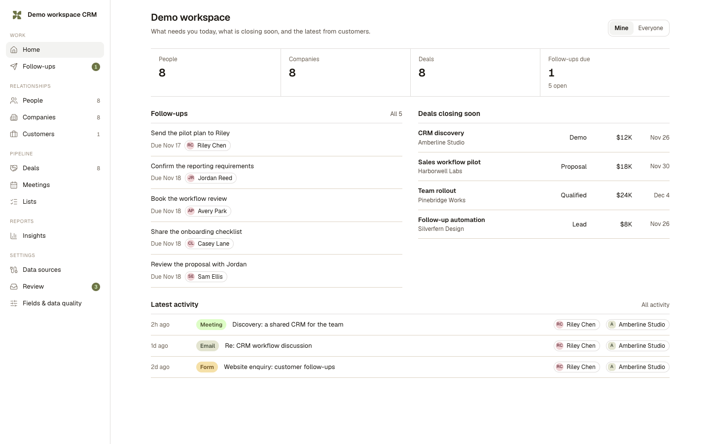

# Self-driving CRM

A CRM that learns how you work. Then runs itself.

Open-source skills and workflows that keep a CRM current on their own and get better every week:

- **Observe.** Email, meetings, bookings, form leads and sign-ups land on the right customer through one intake.
- **Act.** An agent fills blanks, moves meetings, drafts follow-ups for a person to send, and sends real disagreements to Review.
- **Learn.** Correct it in a thread the way you would correct a new teammate, or keep deciding a kind of Review item the same way. It writes the rule down with your name and the date.
- **Improve.** It follows those rules from the next run on, and every Monday shows what it learned and where each rule came from.

The first use case is a CRM. Bring your current CRM's data: HubSpot can be moved once or read every hour while you run both (nothing is written back to it), and other CRMs come in from an export. It runs in [Kylon](https://kylon.io/?utm_source=github&utm_medium=referral&utm_campaign=self-driving-crm), with Kylon's agent or your own (Claude Code, Codex) as a member of the team. How the learning works: [`skills/crm-practice/references/how-it-learns.md`](skills/crm-practice/references/how-it-learns.md).

It is packaged as Skills, so an agent can set it up for a team by asking questions, showing a design and building only after the team says yes. This repo is written for agencies and consultants who build AI systems for their clients, and for teams setting it up for themselves.

## The problem

Almost every small business you walk into has the same customer data problem.

- **The story of a customer lives in five places.** Each person's inbox, the shared sales@ address, the booking tool, the website form, the meeting note taker, Stripe. Nobody can see the whole relationship in one place.
- **The CRM is always out of date.** It depends on people typing things in after a call, and they don't. Within a few months the team stops trusting it and goes back to searching their inbox.
- **Follow-ups slip.** A good meeting ends, everyone means to send the recap, and a week later nobody has.
- **The AI layer has nothing solid to stand on.** An agent can only draft a good follow-up or spot a stalled deal if it can see clean, current customer history. Bolt an agent onto a stale CRM and it confidently works from the wrong facts.

For an agency, there is a second problem on top: every client build starts from scratch. You glue a CRM, an automation tool, a few scripts and an LLM together, and each one becomes a custom system you have to babysit.

## Why this approach works

The idea is simple: stop asking people to update the CRM, and make every source write into it automatically, through one door.

- **One intake for everything.** Every sync, import and automation writes through a single `POST /api/intake`. It matches people by email and companies by domain, skips what it already has, and fills blanks without overwriting. When two sources disagree, the change goes to a Review page for a person to decide. That is what keeps the data clean when a dozen sources feed it.
- **Sources come in on their own.** Each person's Gmail or Outlook (or one company-wide capture rule instead), calendar, booking pages, website forms, meeting recaps, product sign-ups and analytics. Templates for each are in `skills/crm-practice/code/automations/`.
- **One thread per customer.** Every email, meeting, recap and agent action about a customer lands in that customer's own thread, so anyone (or any agent) picking it up sees the full story.
- **Agents draft, people send.** After a meeting the agent drafts the follow-up from the host's own mailbox. A person reads it and clicks send. Nothing goes to a customer by itself.
- **It checks itself.** A daily check flags missing fields, duplicates and sources that stopped syncing, instead of quietly reporting zeros.

That is what we mean by self-driving: the CRM stays current without anyone maintaining it, and people only step in where judgment is needed.

## Why build it on Kylon

You could build this yourself on a database, a web framework, an automation tool and an agent framework. We did not want to, and you probably do not want to rebuild it for every client either. In [Kylon](https://kylon.io/?utm_source=github&utm_medium=referral&utm_campaign=self-driving-crm) the pieces this needs are already part of the workspace:

- **The CRM is a Kylon App.** It gets its own database, API, hosting and sign-in. The source is in `skills/crm-template-source/`, and you can change it like any web app.
- **Each person connects their own accounts.** Gmail, Outlook, Calendar and other tools are connected by their owner and read only under that owner's access. You never collect client passwords or share one person's inbox with the team.
- **Automations run the syncs.** Scheduled or triggered by a webhook, with run history, so a sync that fails shows up instead of disappearing.
- **Agents are members of the team.** They work in the same Rooms as the client's people, can have their own mailbox, and draft emails as cards a person approves. Clients can also bring their own agent, such as Claude Code or Codex.
- **Every record has a thread.** The one-thread-per-customer model is built in, not bolted on.
- **Setups ship as Skills.** The whole install is a set of Skills, so you can run the same setup at your next client, and their own agent can keep maintaining it after you hand over.

For an agency, that means you spend your time on the client's process, not on plumbing.

## What's inside

| Folder | What it is |
| --- | --- |
| `skills/install-crm/` | The setup playbook in four phases: ask, look, design, build. Nothing is built before the team approves the design. |
| `skills/crm-template-source/` | Source of the CRM App: people, companies, accounts, deals, meetings, follow-ups, lists, insights, Review and Data sources pages. Starts with an empty database. |
| `skills/install-email/` | Email setup: personal inboxes, agent mailboxes, shared addresses like sales@, one thread per client, a person sends every email. Builds on install-crm. |
| `skills/crm-practice/` | Our operating rules plus Automation templates: Gmail and Outlook sync, calendar, booking pages, website forms, meeting recap follow-ups, a daily sign-up digest, an email log per customer, PostHog, Microsoft Clarity and a daily data check. |
| `docs/` | Architecture pages for the CRM and for email, a visual guide (HTML and PDF) and screenshots. All people, companies and email addresses in them are made up. |

## Set it up for a client

1. [Create a Kylon workspace](https://kylon.io/?utm_source=github&utm_medium=referral&utm_campaign=self-driving-crm) for the client, or use theirs.
2. Download this repo and add the folders under `skills/` as workspace skills. Start with `install-crm` and `crm-template-source`; add `install-email` and `crm-practice` when you get to email and data sources.
3. In the Room where the CRM should live, ask the agent: "Set up a CRM for us with the install-crm skill."
4. The agent interviews the team on cards, looks at which tools they actually use (only with the owner's OK, mail headers only), and writes a design. Nothing is built, connected or imported until the team approves it.

Open `docs/crm-visual-guide.html` in a browser first if you want to see where you end up.

## What has been tested

We would rather tell you now than have you find out on a client call.

| Part | Status |
| --- | --- |
| `install-crm` with `crm-template-source` | A partner team has used it to set up their own CRM. |
| `install-email` | Preview. Gmail and Microsoft 365 connect directly. Hosted IMAP mail (forwarding to an agent mailbox) and support tools without a connector (webhook) have not been tested; the skill proves each with one test message first. |
| `crm-practice` Automation templates | Type-checked, but none has run on a fresh CRM yet. Every template makes the agent do a dry run on real data, writing nothing, before it is saved. |
| Learning (`how-it-learns.md`) | How we run our own CRM. The rule from repeated Review decisions and the Monday card are documented here; we are running them on a fresh install next and will update this row. |

## Contributing

Issues and pull requests are welcome, especially from people running this at a client. Keep demo data made up (`example.com` style addresses, invented companies) and never commit customer data, keys or workspace IDs.

## License

[MIT](LICENSE)
