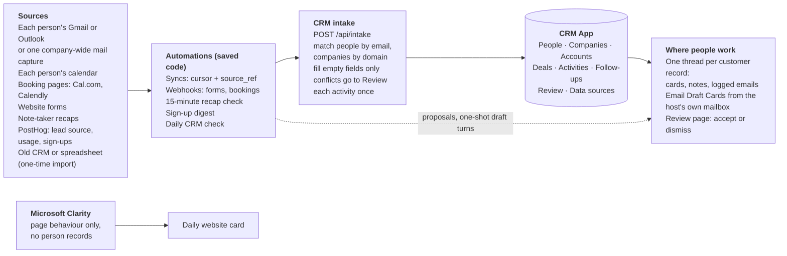

# Kylon CRM practice: how customer data reaches the CRM. Every write goes through POST /api/intake.

Rendered: `architecture.png`. Paste the block below into any Mermaid viewer, or into a Kylon message, to edit it.

