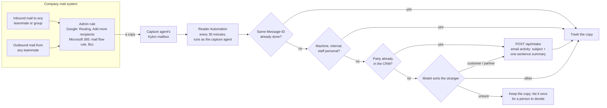

# Company-wide mail capture: one admin rule copies every external email to a Kylon agent's address.

Rendered: `mail-gateway.png`. Paste the block below into any Mermaid viewer, or into a Kylon message, to edit it.

