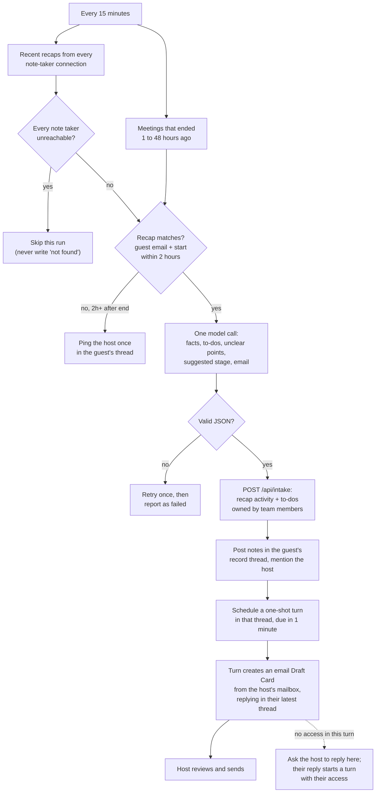

# After every customer meeting: notes, to-dos and a follow-up Draft Card. Nothing is sent automatically.

Rendered: `meeting-follow-up.png`. Paste the block below into any Mermaid viewer, or into a Kylon message, to edit it.

